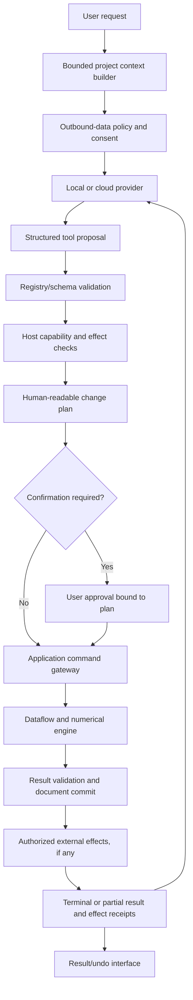

# AI Architecture

Status: design, 2026-10-30. AI is an optional application client, never a privileged implementation of scientific operations. [Command contracts](module-design.md) are authoritative.

## 1. Provider independence

`ModelProvider` describes capabilities (text, vision, structured tools, streaming, context limits), model identity, token accounting, authentication, cancellation and normalized errors. Adapters translate to individual cloud APIs or a local endpoint. Do not equate an 'OpenAI-compatible' endpoint with identical tool, vision or error semantics; negotiate/test capabilities. Raw provider response objects do not enter project files or application command schemas.

Local models can use an optional llama.cpp worker or a user-selected local server. Llama.cpp has a C/C++ inference interface and multiple GGML backends, but ABI stability, cancellation and weights licenses require separate review; see [runtime evidence](../research/graphics-and-runtime.md). Never download weights silently. Record runtime version, model artifact hash, quantization and license metadata. Lack of AI must not block normal application use.

## 2. Tool execution flow

The model proposes commands; the host chooses whether and how to execute. The same schema and implementation serve GUI, Python, CLI and AI. A natural-language explanation cannot bypass authorization. Unknown tool names are errors, not candidates for dynamic evaluation.

## 3. Context management

Default context contains project structure, selected object IDs, schema/units, row counts, cached descriptive summaries, approved small samples, graph specs and available command descriptions. Raw arrays are fetched only by bounded queries with explicit selection and sampling metadata. Provenance tracks which dataset revision and sample supported an answer; missing data cannot be invented.

Apply budgeted hierarchical summaries, explicit truncation indicators and snapshot IDs. Separate user instructions from dataset cells, imported notes, plugin documentation and external content. These may contain prompt injection and have no ability to grant tools or change policy. Context caches are scoped to project/provider/privacy policy and invalidated on revision or consent changes.

Cloud requests show exactly which data categories and selected content leave the machine. Local-only mode enforces a deny rule at the network adapter, including embeddings, telemetry and fallback providers. No silent cloud fallback when a local model fails. Credentials live in OS secret storage; prompts/history/project files contain secret references, not API keys.

## 4. Workflows, validation and history

A workflow is a bounded state machine: plan, propose, authorize, execute, inspect, finish/fail/cancel. Limit steps, wall time, tokens, spend, output sizes, concurrent tasks and repeated failures. Network retries use bounded backoff; effectful commands use idempotency receipts so a retry cannot duplicate an export or edit. Cancellation propagates to provider and application tasks; a late model response cannot revive a canceled workflow.

Example: 'fit these data and make a publication figure' resolves selection/units, proposes a method and assumptions, runs `analysis.fit_curve`, checks convergence/residuals, creates a plot bound to the result, then proposes output destination. It cannot claim statistical significance from an unvalidated narrative. The model may recommend a method, but deterministic checks enforce sampling assumptions, parameter bounds, units and result validity. Scientific judgments remain qualified and reviewable.

Execution records include workflow/request IDs, provider/model, context policy and revision references, structured proposed arguments, approvals, task/result IDs, warnings/errors, timestamps, artifact hashes, document-only undo transactions and external-effect receipts. A document commit is not reported to the model as final success while an export/share effect remains pending; cancellation or failure after partial effects returns a partial-completion record and cannot be described as fully undoable. Store relevant visible rationale and tool results, not hidden model reasoning. Sensitive prompts/history have user-controlled retention and redaction; provenance required to understand a numerical result is separate from optional chat history.

## 5. Permission policy

Read-only metadata can run within an existing scope. Reversible document mutations can be grouped into one approved transaction, with diff and undo. File deletion/overwrite, external process execution, plugin installation, new network destinations, cloud data transfer and sharing require explicit host confirmation with exact targets. No model-generated shell command runs by default. A script-execution tool, if deliberately enabled later, uses an isolated worker, explicit file grants and resource limits; it is not a universal escape hatch.

Confirmation expires on changed arguments/revisions, destination, principal or timeout. Revocation takes effect before commit/external effect. Do not treat a previous session's approval as a project-wide standing grant. Permission decisions are auditable independently of whether the model response is retained.

## 6. Acceptance

Provider contract tests use deterministic fixtures for streaming, tool fragments, malformed JSON, duplicate/reordered tool calls, timeouts, rate limits, truncation and unsupported capabilities. Adversarial tests place instructions in column names/cells/notes and verify no elevated permissions or data exfiltration. Golden workflows cover import, filtering, statistics, fitting, chart styling/export, report generation and explanation grounded in result handles. UI/AI/Python command equivalence tests compare committed domain results, not prose. Offline tests capture attempted network traffic and must observe none. Automated evaluations never upload real user datasets without consent.
