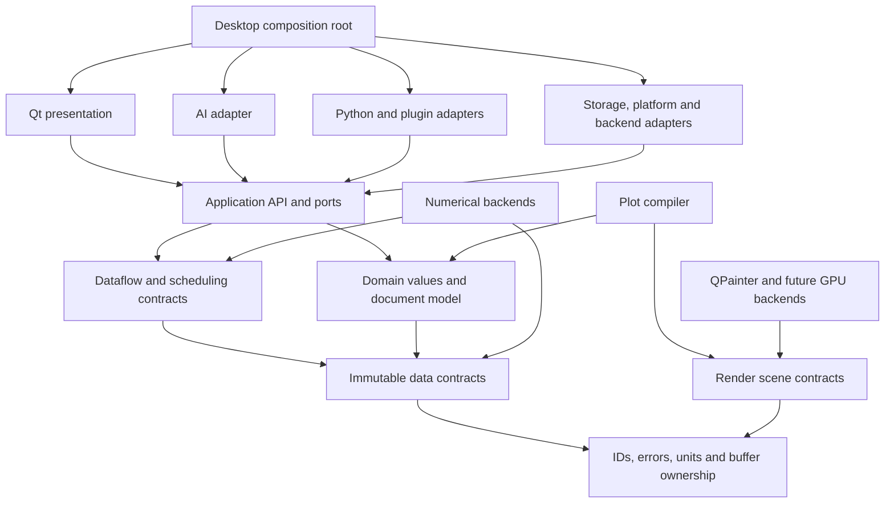

# Architecture Overview

Status: architectural decision for Phase 0, not an implemented application. Evidence baseline: 2026-10-30. See [decisions](../decisions/ADR-0003-application-architecture.md), [module contracts](module-design.md), and [scope](../planning/functional-scope.md).

## 1. Architectural choice

EveryGraph is a **local-first modular monolith with isolated extension workers**. The desktop process contains the trusted application, domain, scheduling and rendering modules. Separate processes are justified by a concrete trust, crash-containment or runtime boundary (third-party code, Python, optional local inference), not by a desire to imitate microservices. No server, account, network connection or AI provider is required for ordinary data analysis.

The preferred implementation is C++20 with Qt 6 Widgets as a replaceable presentation/platform adapter. The domain and application interfaces contain no QObject, QVariant, QModelIndex, QString, QImage, GUI handles, provider SDK types or graphics API handles. Workers expose versioned messages and immutable data references. Future Rust components fit behind narrow C interfaces or worker protocols; introducing Rust does not require changing the document model.

## 2. Compile-time dependency direction

An arrow means **imports/depends on**, not runtime event flow.

The composition root alone chooses concrete implementations. Application ports invert dependencies: an application service can request storage, analysis or rendering without importing their concrete implementation. No application-to-UI edge exists. A domain object never calls a renderer or a worker. A new backend must not become a service locator dependency in every module.

A logical module starts as a CMake target with private headers and explicit public headers; it need not be a shared library. Public headers are checked in dependency tests. UI, CLI, AI and Python share the same commands and queries.

## 3. Runtime flow

```mermaid
flowchart LR
    Entry[GUI / Python / AI / CLI] --> Gateway[Command gateway]
    Gateway --> Guard[Schema, permissions, revisions, confirmation]
    Guard --> Plan[Prepare immutable execution plan]
    Plan --> DAG[DAG scheduler and workers]
    DAG --> Candidate[Candidate outputs and diagnostics]
    Candidate --> Validate[Numerical and domain validation]
    Validate --> Commit[Serialized document commit]
    Commit --> Events[Committed events and undo record]
    Events --> Models[Read models and subscriptions]
    Models --> Compiler[Plot compiler]
    Compiler --> Backend[Renderer backend]
    Commit --> Save[Explicit save / recovery checkpoint]
```

A completed worker task is not a committed document change. A valid candidate can still be rejected because input revisions changed or permission was revoked. UI state such as hover, current zoom and transient selection is separate from persistent scientific state; only intentional saved view changes create document commands.

## 4. Workspace and document composition

Use a QMainWindow-based workspace, menus, command palette, toolbars and QDockWidget-based project tree, properties, analysis and AI panels. A central document host provides tabs and detachable documents; do not assume tab/detach state management is supplied by Qt automatically. Each top-level window has a workspace coordinator. A project may have workbook, matrix, graph, layout/report, image and notes documents. Keyboard navigation, accessibility, IME, high DPI and multiple monitors are acceptance criteria from P1, not a later theme.

A virtualized table adapter exposes requested ranges from column snapshots, never one widget or model object per cell. Plot editing produces commands; the canvas does not own the scientific dataset. Render requests consume immutable scene snapshots. Dock layout and user preferences live in user configuration, not mixed with dataset payloads.

## 5. Scientific correctness and trust boundaries

- Imported bytes are untrusted. Bound size, nesting, expansion ratios, parser time and allocation before committing data; dangerous parsers may run in workers.
- Raw imported values retain full precision and provenance. Editing creates a new revision; display level-of-detail is not a scientific transformation.
- Unit changes distinguish display conversion from value transformation. Null, IEEE NaN, masked, filtered-out and failed-result states are different.
- AI text, imported notes and plugin metadata are data, never authority. Permissions are enforced by the host gateway.
- A separate process is crash isolation, **not automatically an OS sandbox**. Untrusted-code support is disabled until each platform's containment tests pass.
- File opening never executes embedded code, reconnects to remote sources, loads native plugins or sends data to a model automatically.
- Telemetry is off by default. No datasets, prompts or credentials enter routine logs.

## 6. Architectural fitness checks

CI will enforce an acyclic target graph, no Qt dependencies in domain/application public headers, no provider SDK in command schemas, and no mutable shared dataset buffers. Contract tests replay identical commands through GUI test adapters, Python and AI gateways. Failure-injection tests cover cancellation, stale results, out-of-memory admission failure, worker crashes and interrupted saves. Renderer tests compare semantics before pixel appearance.

The Phase-0 build verifies only toolchain and planning invariants. These architectural tests become executable with the corresponding modules; they must not be reported as already passing.

## 7. What is deliberately not built yet

No distributed scheduler, cloud project backend, real-time multi-user editing, general GPU compute framework, bespoke programming language, arbitrary in-process extension loading or replacement for all VTK subsystems is required to establish the application. Full inventory capability coverage remains the long-term target, including 3D, GIS, advanced statistics and external integrations; staging those packages is not deleting them from scope.
