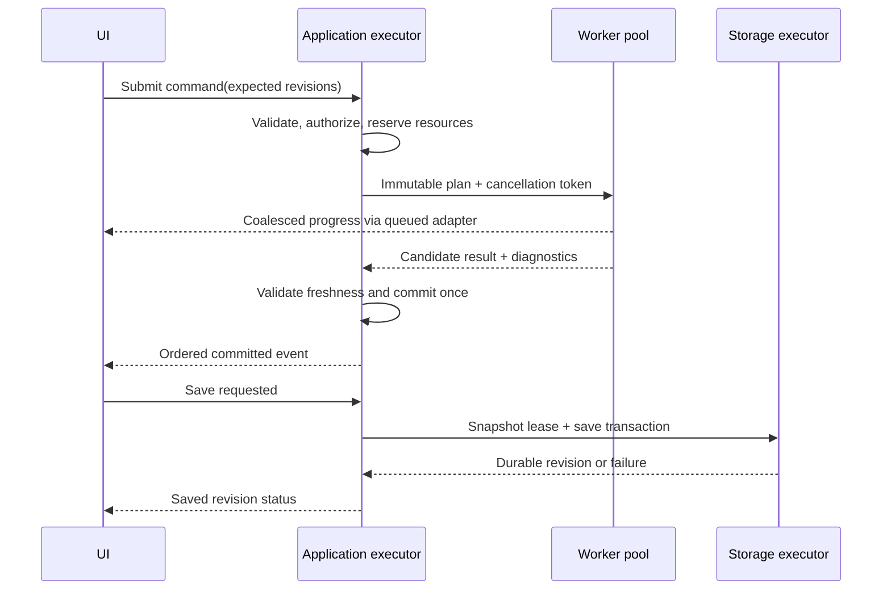

# Concurrency and Dataflow Model

Status: design contract, 2026-10-30. This defines ownership and state transitions; thread counts and timing budgets are benchmark hypotheses.

## 1. Execution domains

| Domain | Owns | Must not do |
|---|---|---|
| UI main thread | Qt objects, focus/input, presentation read models, final canvas paint | Parse files, solve fits, block on futures, wait for plugin/AI or own long DB transactions |
| Application executor | Serialized command decisions, document revision commits, undo cursor and event order | Mutate Qt objects or execute long numerical kernels |
| CPU worker pool | Immutable task input leases and private candidate outputs | Modify live document objects or publish unvalidated results |
| I/O executor | File/database/network operations, import builders and save streams | Perform unbounded CPU work or share a DB connection unsafely |
| AI async tasks | Provider streams, tool proposals, context budgeting | Call native memory directly or authorize themselves |
| Render preparation | Layout/LOD work and immutable scene compilation | Touch a QWidget/QPixmap from a worker |
| UI paint / future GPU queue | QPainter widget paint on UI thread; backend-specific GPU resource/submit ownership | Reuse freed resource leases or issue arbitrary cross-thread graphics calls |
| External worker process | Python runtime, plugin instance or optional model runtime | Write the host document, bypass the capability broker or block host shutdown |

One configurable CPU pool is shared across modules. Start with reserved UI/I/O headroom; select pool size by measurement, not a universal `hardware_concurrency()` rule. BLAS/OpenMP/third-party solver threads participate in the same total budget; avoid nested oversubscription. Separate queues are scheduling classes, not necessarily separate fixed thread pools.

## 2. DAG node contract

A registered `NodeDefinition` contains a stable type ID and version, typed input/output ports, parameter schema, executor, purity/determinism declaration, chunk/incremental capability and resource estimator. `NodeInstance` contains parameter values and resolved input bindings. Inputs may be datasets, grids, scalars, masks or analysis-result records, never GUI objects. A renderer is a terminal consumer; export is a side-effect command, not a freely cacheable computation.

Validation checks port compatibility, units/shape, null policy and acyclicity at graph-edit time. Topological scheduling runs ready nodes only after all required parents produce valid outputs. Independent branches may run concurrently within memory/CPU admission limits.

Cache key = hash(node type + algorithm version + canonical parameters + input content/revision fingerprints + selection/mask + unit policy + relevant execution environment + random seed). Revision hashes avoid rescanning complete inputs on every invocation; imported immutable chunks receive content hashes during ingestion. Non-deterministic/external nodes are not cached as pure nodes. Library, precision or backend changes invalidate results when they can change numerics.

Node states: `idle -> ready -> running -> succeeded | failed | canceled | superseded`. `stale` describes a previously valid cached/published output whose input revision changed, not a successful new result. Downstream nodes become blocked when a required parent fails. A partial fit is a labeled candidate with diagnostics, never silently a successful numerical result.

## 3. Invalidation and incremental execution

An edit marks affected chunk/range/version dependencies dirty and propagates through the reverse-edge index. Local elementwise operations recompute dirty chunks. Append-aware statistics use numerically specified mergeable accumulators; subtraction/retraction requires a different contract. Global nonlinear fits, arbitrary Python functions and operations without proven incremental semantics recompute completely. Debounce UI drags, merge superseded requests and cancel obsolete preview tasks. A final action must schedule the full validated result even if previews were coalesced.

A changed viewport invalidates display LOD/layout, not a numerical analysis. A style edit invalidates scene compilation, not data buffers. A mask change invalidates exactly consumers whose selection policy includes that mask. Quantify cache hit rates and invalidation fan-out in benchmarks.

## 4. Cancellation, progress and memory

Commands return task IDs immediately. Cancellation is cooperative via `std::stop_token` or an adapter token at chunk/iteration/I/O boundaries. A canceled computation discards private candidates and releases resource reservations; it does not roll back an unrelated committed command. A document commit is a short non-cancelable state transition. For a document-only command, cancellation after its terminal commit reports completed and offers undo. For a command with external effects, document commit is nonterminal: cancel/revoke remaining effects before their irreversible boundaries, retain receipts for completed effects, and report partial completion if any document change or effect already committed. Never label a pending/failed export as completed or imply document undo reverses an external effect.

External workers that cannot cooperate can be terminated after a deadline **within their worker process**, with cleanup of leases/temp outputs. Never force-kill a shared host thread. Progress uses task ID, stage and completed/total work when known; unknown totals remain indeterminate. Queue at most a bounded number of updates and coalesce rather than flooding the UI.

The scheduler reserves estimated resident and spill bytes before execution. Allocation growth triggers re-admission or a structured resource error. Backpressure applies to streams, imported batches, provider tokens and render submissions. Deadline priorities favor input/paint and explicit interactive work over speculative previews or batch jobs; aging prevents starvation.

## 5. Publication and lifetime

The application executor is the only logical writer to the document. Workers return values through queues; immutable snapshots and `shared_ptr<const Buffer>` leases cross threads. Locks protect short registries, never whole datasets during analysis. No lock is held while invoking a plugin, network call, event subscriber or foreign-runtime callback.

Each result includes exact input revisions. Unrelated document edits need not invalidate it: check the read set, not only a global revision counter. Conflicting writes are rejected or explicitly rebased by a new command. Events are emitted only after an atomic commit with monotonic sequence numbers; subscribers cannot mutate the document reentrantly.

Python runs in a worker with its own interpreter/GIL and environment. Whether NumPy releases the GIL depends on the operation; this is not an application scheduling guarantee. Async I/O is not CPU parallelism. GPU resources are released on the owning backend queue after fences complete, not when the originating C++ scope happens to exit.

## 6. Validation gates

Tests must cover slow/failing/canceled nodes; duplicate submissions; stale outputs after edits; revision conflicts; bounded queues; memory exhaustion; cyclic graph rejection; save during analysis; worker death; UI close during jobs; callback reentrancy; GPU loss and pool oversubscription. Run ASan/UBSan and a separate compatible TSan configuration; sanitizer availability differs across compilers/platforms. Deterministic schedule fuzzing and race tests supplement, not replace, compiler-enforced ownership and review.
