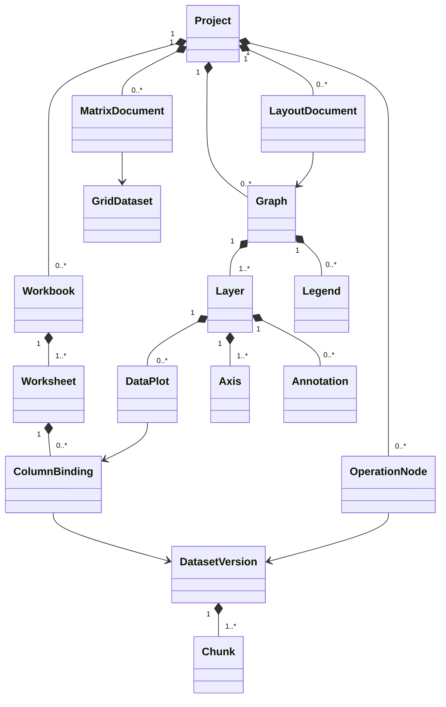

# Scientific Data Model

Status: design contract, 2026-10-30. References: [Arrow columnar format](https://arrow.apache.org/docs/format/Columnar.html), [C Data Interface](https://arrow.apache.org/docs/format/CDataInterface.html), [NumPy integration](https://arrow.apache.org/docs/python/numpy.html), [lazy queries](https://docs.pola.rs/user-guide/concepts/lazy-api/). These are rolling official documents, not pinned dependency releases.

## 1. Object graph

IDs are stable opaque 128-bit identifiers, never array indices or translated names. The ownership tree organizes documents; references form a separate graph. The **operation dependency graph must be acyclic**; normal object references can be bidirectional via indexes without implying cyclic execution. Deleting a referenced object requires an explicit dependent-object policy and undoable transaction, never dangling IDs.

| Object | Persisted contract |
|---|---|
| Project | Schema/features, document ownership tree, revision, operations, templates, variables, notes and provenance |
| Workbook | Ordered worksheets, shared metadata and labels; not the data allocation unit |
| Worksheet | Logical rectangular table, row-order mapping, typed column bindings, labels, grouping and view filter |
| ColumnBinding | Stable column identity, dataset/field reference, role (X/Y/Z/error/label), unit, display format and explicit alias/write policy |
| DatasetVersion | Immutable schema, buffers/chunks, row identity domain, provenance and revision ID; a new edit yields a new version |
| Graph / Layer | Physical page size, layer order, coordinate system, axes and bindings; GUI-independent |
| DataPlot | Plot specification, source bindings, mask policy, styles and selection mapping; no copied source array |
| Axis | Transform, domain constraints, tick strategy, units, breaks and link relationship |
| Legend / Annotation | Semantic references, text/style, anchoring in data/layer/page space; token expressions are safe ASTs |
| OperationNode | Typed input references, algorithm/version, validated parameters, random seed and result references |
| Variable | Number/text/menu/slider/time/font/color/marker value or safe expression; explicit dependencies |
| Matrix / Image / Grid | Shape, dtype, axes/spacing/origin, tile storage, channels, optional CRS; not coerced to a table |
| Layout / Report / Notes | Blocks referring to versioned tables, graphs, result records or sanitized text |

A figure can bind to live column identities (latest valid version) or frozen dataset revisions; the user can distinguish these modes. Report exports always capture a resolved revision set.

### Worksheet row alignment

A worksheet has one row-identity domain and ordered row set. Each binding either shares that domain or carries an explicit correspondence from worksheet row ID to source row ID (or unmatched). Never zip unrelated columns by current array position. Importing/mirroring into an empty worksheet can adopt the source domain; adding a foreign-domain column requires a declared keyed join or a user-approved positional mapping captured as stable ID pairs. Duplicate join keys require an explicit expansion/aggregation policy. Unmatched rows expose a missing correspondence without mutating source values, and analyses apply their declared pairing/missing policy.

Sorting/filtering changes the worksheet view, not correspondence IDs. A same-domain mirror may explicitly follow source-domain insertions/deletions as one rectangular worksheet revision; all affected bindings and formula/plot references are validated together. A foreign-domain mapping keeps existing pairs stable: new source rows are not silently paired with unrelated target rows, and deleted source rows become unmatched. An explicit refresh-alignment command applies its recorded join/append policy. Value updates propagate through existing source IDs. Validate row counts, mapping cardinality and X/Y/error pairing transactionally; rejected alignment changes leave the previous revision intact.

## 2. Storage choice

Use immutable, chunked **columnar arrays** for tabular data; Arrow C++ arrays, schema and IPC are the initial interoperability/storage implementation behind a small buffer/type port. Avoid exposing Arrow object graphs throughout all application APIs. Add Parquet for analytical interchange and external partitioned data, not as the mutable project object database. Polars is an optional measured query backend, not a second mandatory dataframe engine. Eigen handles dense numerical workspaces, not heterogeneous document storage.

Columnar SoA improves projection, streaming, SIMD and compression when operating on a few columns. AoS/row layout remains useful for small event records, command metadata and row-oriented ingestion before column builders finish. Neither layout universally wins. Chunk size is a configurable internal policy chosen by benchmarks (starting experiment: 64K rows, with a byte cap for wide/text columns), not a persisted assumption.

Arrow offers contiguous buffers and validity bitmaps, but mutation is comparatively expensive. Use chunk-level copy-on-write: an edit allocates only affected chunks, publishes a new dataset version and preserves the old chunks for active readers/undo. Reordering changes a row-index view; materialization is explicit and budgeted. A view is not always faster than copying: fragmented gathers must be profiled.

## 3. Types and scientific semantics

Initial logical types: signed/unsigned integer widths, float32/float64, boolean, UTF-8 text, categorical/dictionary, date, duration and timestamp with explicit timezone interpretation. Preserve source lexical tokens and import errors where a numeric/date parse is ambiguous. Later complex values use a registered real/imaginary extension representation; grids support shape/strides without pretending arbitrary tensors are Arrow record batches.

- Null means absent; NaN is a floating-point payload; infinity is not silently clipped. Per-operation handling policies are parameters recorded in provenance.
- Scientific exclusion masks are independent bitsets with reason/author; a UI visibility filter does not silently exclude values from an analysis. Commands resolve an explicit selection/mask scope.
- Units carry dimension, scale, offset and source text; offset temperature conversion is not ordinary multiplicative algebra. A unit library decision must cover uncertainty and compound units before adoption.
- Timestamp parsing records locale, timezone and DST ambiguity decisions. Export does not silently change to local time.
- Display precision never rounds stored values. Serialization round-trips the bit representation where the format supports it.
- Uncertainties may be symmetric/asymmetric per-point columns or result covariance. A derived algorithm states its propagation assumptions; generic automatic propagation is not implied.

## 4. Shared access and zero-copy limits

`DatasetHandle` resolves an immutable version with a lifetime-owning lease. A read view contains dtype, shape, validity, strides, buffer references and offset; no naked span may outlive its owner. A writer owns a private builder and can publish only through the application transaction.

Arrow C Data release callbacks transfer lifecycle responsibilities, not ownership of arbitrary project state. They are for **same-process** interoperability. Cross-process data uses Arrow IPC files/streams or broker-created shared-memory mappings with separately validated descriptors, read-only access and explicit leases. A process address is never an IPC reference. Windows mappings and macOS descriptor handoff have separate platform implementations.

Zero-copy is conditional: matching numeric dtype, alignment, contiguity, lifetime and null representation are necessary. A chunked nullable column often requires NumPy masked-array adaptation or a copy. `Eigen::Map` is permitted only after dtype/alignment/stride checks and while the lease lives. SQLite BLOB reads generally copy into a chunk cache; choosing SQLite for atomicity does not confer memory mapping of Arrow arrays. Parquet decompression and CSV parsing necessarily allocate. Record copy bytes in profiling rather than labeling an entire pipeline zero-copy.

## 5. Mirrors, formulas and outputs

Mirror/redirect columns are bindings to the same data identity, not duplicate storage. Default mirrors are read-only; an explicit shared-edit operation or detach-to-copy command avoids surprising writes. Formula cells and columns store parsed ASTs, typed references and dependency edges. Stable IDs survive renaming; relative spreadsheet references are normalized with a documented structural-edit policy. Detect cycles across variables, columns, cell formulas and analysis-output tokens before commit.

A histogram/fit plot can expose output columns and scalar tokens, matching command-output workflows without computing inside the renderer: the application creates an analysis node and the plot binds to its result. Variables driving that node must not depend back on its outputs. A clock or animation variable changes only through explicit scheduled input events; it is not a hidden nondeterministic function in a cached node.

## 6. Large data and lifecycle

Use incremental import, chunk caches with measured byte budgets, lazy range reads, bounded prefetch and an admission-controlled scheduler. Cache keys include input revisions and parameters; cache eviction never removes the only durable source copy. Workspace/undo references pin chunks and count against memory/disk budgets. A save or export holds a stable snapshot while the user continues editing. Dirty chunks cannot be discarded as if recomputable.

A row has stable identity within a dataset lineage. Filtering retains source IDs; aggregation produces output IDs plus group membership/provenance; joins define composite lineage; resampling records input intervals. Point picking returns original row IDs, not screen-sample indices. Out-of-core processing is algorithm-specific: a global sort, exact quantile or nonlinear solve can need external work files or refuse execution with a resource estimate.

## 7. Required tests

Round-trip types/units/missing values; immutable alias behavior; formula-cycle rejection; stable references under rename/reorder/delete/undo; same/foreign-domain mirrors under source insertion, deletion and independent sorting; unequal-length X/Y/error alignment and unmatched-row policy; null/NaN differences; Unicode labels; timezone/DST; decimal-comma import; canceled chunk builders; leased-buffer lifetime; cross-process bounds and stale-handle rejection; repeated edits within the memory budget. Property tests compare columnar and scalar reference implementations. Fixtures cover workbook, matrix, image and linked figure projects, not only XY vectors.
