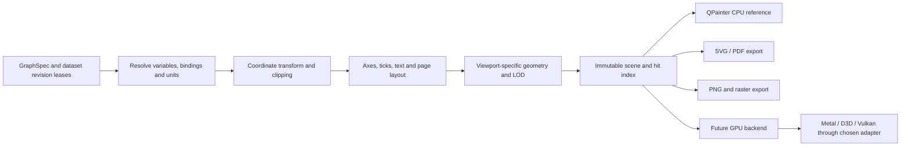

# Scientific Plotting and Rendering Architecture

Status: design, 2026-10-30. CPU first; GPU adoption is conditional on measured end-to-end benefit. [Graphics evidence](../research/graphics-and-runtime.md) distinguishes borrowed ideas from actual upstream implementations.

## 1. Own the scientific scene

EveryGraph owns Graph/Layer/DataPlot/Axis/Legend/Annotation and the transformation/layout/hit-testing model. A general chart widget is not the scientific engine. Qt supplies a desktop canvas, text/layout facilities and drawing/export adapters; it does not define analysis semantics or project serialization. Qt Charts/Graphs are not baseline dependencies.

This is an execution pipeline, unlike the import-dependency diagram. Exports choose their own detail policy before scene compilation; they must not reuse a screen-reduced buffer without disclosure.

## 2. Scene contract

A SceneSnapshot has a version, page dimensions in physical points, device scale, color-space policy, ordered draw groups, clips, transforms, styles, glyph runs, paths, images and pick IDs. Backend capabilities describe supported blending, gradients, text, vector paths, mesh primitives and offscreen/export paths. Resources use opaque leases with explicit lifetimes.

The renderer accepts a scene and a target description and returns completion/diagnostics; it cannot mutate a Project or Dataset. Backend-neutral paths, affine transforms and colors do not contain `QPainter*`, `MTLDevice`, D3D handles or Vulkan objects. A backend resource cache maps immutable content IDs to device resources. Unsupported features trigger a deliberate software/raster fallback with diagnostics, not missing objects. The CPU reference stays available for headless correctness tests and GPU failure recovery.

Scientific coordinates remain float64. Very large x values (timestamps) subtract a local origin in double precision before float32 GPU conversion. Log, reciprocal, probability, polar, ternary, axis-break and secondary-unit transforms define domain restrictions and inverse mappings. Invalid log-domain samples form explicit gaps; no line crosses a missing segment. Multi-layer coordinate spaces and z-order are explicit.

## 3. CPU reference and professional editing

Initial implementation uses a custom Qt widget for the plot, a semantic retained scene, and QPainter for paths/text/images. QWidget painting occurs on the UI thread. Heavy scene compilation and suitable QImage/offscreen work may run on workers with isolated painter/device state; QWidget/QPixmap remain thread-affine. Consider QGraphicsScene for editor overlays only after profiling; **do not create one QGraphicsItem per data point**. QPainter on a QWidget is not automatically a GPU renderer.

The editor includes axis/legend/property inspectors, object selection, snapping, constraints, layer ordering, grouping, insets, annotation anchors and transactional drag edits. Selection distinguishes a scene object from an original data row. Accessibility exposes semantic objects and tabular alternatives; a GPU canvas must not erase keyboard access.

Initial types: XY line/scatter, bars, histogram, error bars, heatmap and contours. Later scene primitives support all [functional families](../planning/functional-scope.md), including categorical/statistical/specialized plots, formulas, images and publication layouts. Contour interpolation and histogram binning are analysis nodes, not opaque renderer-side calculations. Formula text initially supports a declared subset with an audited math-layout engine decision; system TeX execution is never an implicit dependency.

## 4. Million-point and ten-million-point curves

- Preserve full data in dataset chunks and compute viewport bounds from chunk metadata/spatial indexes.
- For monotonic x, use per-screen-column min/max envelopes preserving extremum positions and ordering; retain first/last samples and split at invalid segments.
- LTTB is an optional visual approximation with documented tradeoffs; it can miss narrow extrema and is not an analysis input. Evaluate it against peak/step/oscillation adversarial fixtures.
- Screen-pixel adaptive sampling keys on data revision, view transform, viewport/DPI, mask and plot semantics. Recompute after zoom/pan. Non-monotonic paths require order-preserving segmentation; sorting x would change the scientific meaning.
- Dense scatter uses screen bins/density/instancing with disclosed mode; exact selection resolves original data with an index/refinement pass. Do not pick only sampled representatives.
- Export defaults to full-data vector geometry where feasible. Above an explicit complexity/memory budget, offer user-approved exact rasterization or declared export-resolution sampling; never silently simplify publication data.

Benchmarks measure LOD build time, first meaningful frame, subsequent interaction latency, peak memory, upload/copy bytes and point-picking accuracy, not only GPU draw FPS.

## 5. GPU decision gate

Candidate paths are a thin Qt-supported graphics integration, wgpu through a narrow adapter, or platform-native Metal/D3D/Vulkan. Qt Quick's scene graph and Rendering Hardware Interface are useful research references, but Qt private APIs introduce version coupling; confirm the exact selected Qt API's support stability before adopting it. An all-Quick UI is not required to gain a GPU plot surface. wgpu adds Rust/FFI/toolchain/device-lifetime costs in a C++ application. Native APIs offer control but multiply shader, driver and test maintenance.

Choose a backend only after P3 CPU baselines show a dominant rendering bottleneck that data layout, clipping and LOD cannot address sufficiently. Prototype the same scene on macOS and Windows, including text, antialiasing, selection, resize, multi-monitor DPI, offscreen export and device-loss behavior. GPU instancing helps repeated markers; compute shaders may help selected kernels but are not a universal accelerator. CPU-GPU synchronization and upload costs count in the result.

Blender's graphics backend, Zed's UI renderer, and VTK's scientific renderer solve different problems. Optional VTK-backed 3D scenes in P7 use explicit grid/mesh adapters; adopting VTK must not replace the publication-quality 2D document model or force its OpenGL/other backend choices onto the entire UI.

## 6. Export correctness

SVG and PDF preserve paths, text semantics where possible, clipping and physical dimensions. Fonts need availability/embedding-rights checks; offer outlines with a size/accessibility warning when embedding is unavailable. PNG has explicit pixel dimensions, DPI metadata, background/alpha and color conversion. Add TIFF/JPEG/BMP, EPS/EMF, MP4, document/report formats and proprietary DTG only through the separately tracked adapters/gates.

Use one layout engine for on-screen and export geometry. Golden scenes test axis labels, scientific notation, Unicode/CJK, math, font fallback, transparency, line widths and clipping. Verify exports with an independent reader and structural checks; cross-platform antialiasing differs, so tolerances apply to pixels but not to missing objects or wrong data coordinates. EPS lacks general transparency; flatten/reject explicitly. Animation pins inputs and evaluates a declared frame clock, rather than recording UI timing.
