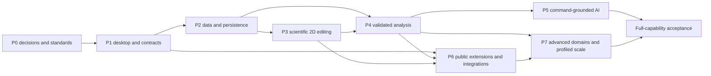

# Development Roadmap and Acceptance Gates

Status: scope-preserving plan, 2026-10-30, updated 2026-10-31 for macOS-first platform sequencing ([ADR-0005](../decisions/ADR-0005-platform-sequencing.md)); Windows x64 remains required but deferred. The [functional scope](functional-scope.md) and [428-row traceability register](feature-traceability.csv) are the capability baseline. No business capability is implemented in Phase 0.

## 1. Delivery policy

Build a reliable vertical foundation before expanding domain breadth. All supplied capabilities remain required long-term, including advanced analysis, matrices/3D/GIS/images, reporting/animation and integrations. A narrow first usable release is not full Origin/DataGraph parity. Optional installable capability packs remain supported product deliverables. Source/ABI/proprietary-file compatibility has separate feasibility/legal gates and cannot be claimed through a merely similar feature.

P5 and P6 are capability streams rather than a forced total order: introduce the worker/command protocol at P1, use a restricted trusted Python numerical worker at P4 when useful, and productize its public API/plugin management at P6. That avoids making advanced statistics wait for an entire plugin marketplace. Start performance/security/accessibility tests in every phase; P7 is advanced optimization and domain completion, not the first time performance matters.

## 2. Dependency graph

## 3. Phases and exits

| Phase | Required work | Exit evidence / blocking gate |
|---|---|---|
| **P0 — planning and engineering foundation** | Source-grounded research, language/UI decision, module/data/render/AI/security/storage contracts, AGENTS, inventories and release-item mapping, minimal toolchain scaffold | Documentation/coverage checks; local toolchain result; explicit Windows/Qt/dependency/legal/catalog gaps with owners. This is planning completion, not full P1 qualification or closed parity research. |
| **P1 — macOS shell and contracts** | Main window/menu/toolbars/docks, tabbed/detachable docs, project tree, preferences, accessibility; command/query/error/revision/event/undo contracts; worker handshake prototype | Native macOS arm64 build with declared minimum-version evidence; keyboard/IME/high-DPI/multimonitor workflows; no Qt in domain/application interfaces; create/edit/undo fake domain fixtures; signed-test packaging and LGPL replacement experiment. Windows x64 replication (P1-002, P1-010) is a deferred later gate and does not block the macOS P1 exit (P1-013). |
| **P2 — data, import, formulas and persistence** | CSV/TXT, clipboard, typed columns, worksheet edits/groups, stable row/column IDs, masks/mirrors, formula DAG, core reshapes; XLS/XLSX/XLSM adapters; SQLite/Arrow project save/load/migrations/recovery | Typed/locale/null/units/precision fixtures; formula cycles and invalidation; 100MB/1GB import measurements; interrupted-save recovery; bounded virtual table; unsupported Excel formulas diagnosed rather than silently changed. |
| **P3 — professional 2D scene and editing** | XY/scatter/bar/histogram/heatmap/contour, axes/layers/legends/annotations, variables, selection/pan/zoom, publication sizing, SVG/PDF/PNG; digitizer and specialized 2D families in subpackages | Golden coordinate/scene/export tests on macOS Apple Silicon, with Windows replication reserved for the deferred gate; full-data analysis separate from LOD; 1M/10M curve baselines; exact picking; accessible editing; font/DPI/clip/math-policy verification. |
| **P4 — scientific computation** | Descriptive statistics/regression/interpolation/calculus/FFT first; then constrained/global/implicit/ODR fits, peaks, signals/wavelets, advanced tests/ANOVA, multivariate, DOE/SPC, ML, survival/time series and Gadgets | Per-method reference results/tolerances/options; diagnostics for singularity/nonconvergence/invalid assumptions; numerical backend locks; scientific review; cancel/concurrent workloads; advanced families not signed off via one generic solver. |
| **P5 — AI** | Provider/local adapters, context budget/privacy, structured tools, workflow history, project/data understanding, natural-language analysis/charting/report assistance | Same domain results through UI/AI/Python contract clients; malformed/adversarial tool rejection; exact outbound context consent; no network in local-only mode; audit/undo and bounded cost/cancellation. |
| **P6 — scripting, integrations and productivity** | Public Python API, plugin management, external/native engines, CLI/replay, connectors/SQL/cloud, batch/templates, reports/slides/animation/MP4, advanced output/document formats, native protected/package project format, proprietary compatibility packs | API/version/lifetime tests, macOS worker containment (Windows replication when the deferred gate resumes) or an explicitly trusted-only policy, license/SDK gates, complete supported-format matrices, external-reader round trips, no secrets/macros autoexecution, protected recovery and update rollback tests. |
| **P7 — advanced domains, scale and ecosystem** | Matrix/grid/3D/surface fit, image processing, RS/GIS, domain graph catalogs; measured SIMD/GPU/out-of-core improvements, optional remote execution and ecosystem services | Domain-specific numerical and geometry tests; coordinate/CRS/image semantics; device/driver fallback; stable-hardware benchmark evidence; complete catalog reconciliation and all required source/added acceptance rows closed. Remote services remain a separate deployment decision. |

Platform sequencing follows [ADR-0005](../decisions/ADR-0005-platform-sequencing.md): macOS 14.4+ Apple Silicon is the only active qualification target; Windows x64 is a deferred later gate whose requirements and platform interfaces remain. Windows builds, evidence, packaging and support claims are not authorized until a Windows x64 host or authorized CI qualifies them, and no Windows task blocks the macOS exits.

CSV phase is a row's completion gate, not necessarily its start. Mixed table/matrix or 1D/2D families deliver simpler components earlier. P2 native save does not promise P6 encryption or foreign project import. Source catalog-discovery rows start in P0 and remain open until their associated parity milestones, without pretending missing public names are already known.

## 4. Work packages and full-parity reconciliation

Maintain a named graph catalog, numerical method catalog, import/export version catalog, plugin/integration compatibility matrix and release-detail tests. Decompose each compound inventory row before implementation. Add stable children without deleting its original source ID. A completed parent requires all children and shared suites, not just one example from the family. Duplicate source IDs may share one implementation with multiple acceptance mappings.

Examples requiring dedicated packages: Life Science structured data; nearly 200 fit functions and 25+ peak functions; ODR/implicit/surface formulations; DOE optimal/binary-response/variability designs; power/reliability/survival/acceptance sampling; specialist hydrochemistry plots; image morphology/filtering; Prism and instrument connectors; MHTML/EMF/EPS/MP4 and Office/COM workflows. None is silently assigned to 'miscellaneous future work'.

The full-capability milestone cannot close while undocumented vendor catalogs, proprietary rights or unresolved platform capabilities are represented only by umbrella rows. If feasibility prevents a requirement, record evidence and seek an explicit product-scope decision rather than substituting an unannounced equivalent.

## 5. Capacity and estimate policy

No staffing, budget or target date was supplied. Assume a small team with systems/data, desktop/rendering, numerical-method and QA/platform skills, with part-time security/legal review. P1–P3 are already substantial multi-quarter work for such a team; complete advanced parity is plausibly multi-year and must be estimated from decomposed method/format catalogs. These are order-of-magnitude planning judgments, not delivery promises or measured productivity.

Do not assign calendar deadlines from the 428-row count: one metadata constraint and an advanced statistical family differ by orders of magnitude. Re-estimate after P1 vertical experiments and catalog decomposition, with separate effort for algorithms, UI, fixtures, documentation, packaging and maintenance. A 1.0 date must specify its accepted capability set; it must not imply full parity by default.

## 6. Immediate next work

1. Qualify the selected Qt patch and minimal workbench on macOS Apple Silicon, including export/accessibility/packaging and replaceable LGPL libraries. Resume the deferred Windows x64 qualification only on a Windows x64 host or authorized CI.
2. Establish actual dependency pins and vcpkg feature closure; validate the compiler/runtime/CRT combinations and SBOM.
3. Decompose unresolved catalogs/compatibility requirements and assign scientific/format owners.
4. Implement the first command-driven vertical slice only after the architecture gate: import a small fixture, inspect typed data, create an XY plot, save/reopen and undo an edit.
5. Turn design contracts into module-level tests and collect the first truthful application benchmark baseline.

## 7. Open risks and owners

| Risk | Responsible role | Closure evidence |
|---|---|---|
| Windows 10 reaches final Qt branch; OS security lifecycle | Platform/release lead | Version/patch support policy and explicit migration decision |
| C++ ownership/race defects | Core lead | Boundary review, sanitizer/fuzz tests and incident metrics |
| Plot precision/export/text parity | Rendering lead | macOS scene/export corpus and independent-reader results now; cross-platform corpus when the Windows gate resumes |
| Full scientific catalog and numerical validity | Scientific lead | Enumerated methods, references/tolerances and reviewer sign-off |
| Unknown/proprietary formats/languages/SDKs | Integration lead + legal review | Lawful spec/fixture access, compatibility matrix and licensing |
| Native/Python containment and packaging | Security/platform leads | OS-enforced denial tests, trusted-only fallback policy |
| SQLite chunk performance and recovery | Data/storage lead | Large-save benchmarks, failure injection and migration fixtures |
| Scope exceeds team capacity | Product/technical leads | Decomposed estimates and explicitly accepted release scope |

Roles are responsibilities to assign, not named people or an already staffed team.
